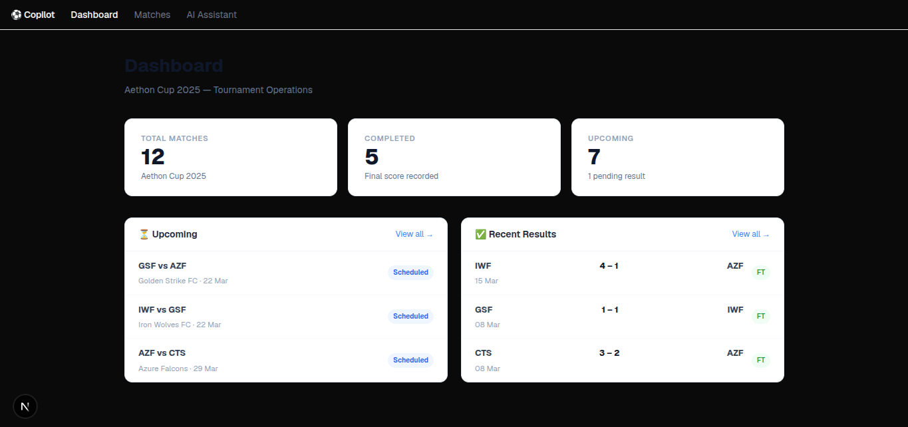
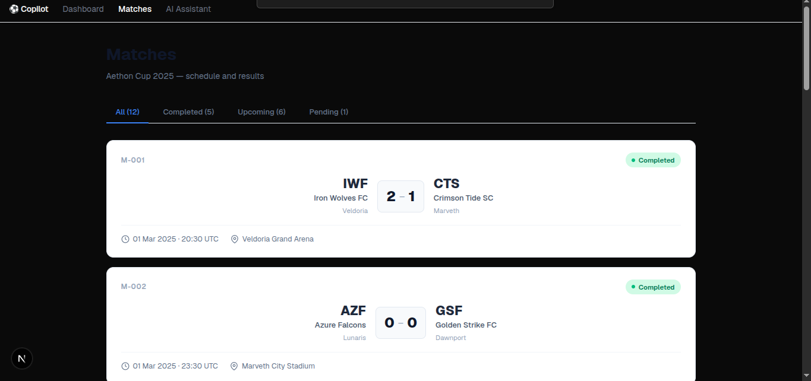
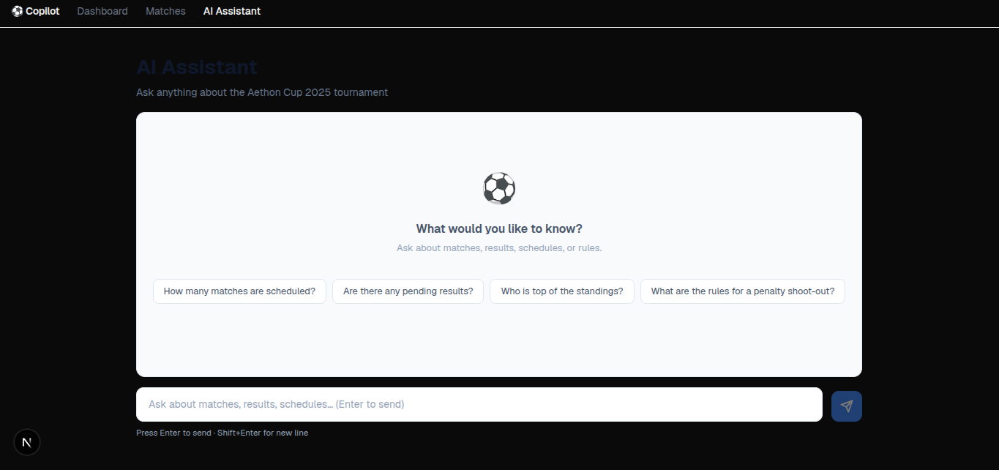

# AI Tournament Operations Copilot

An AI assistant for sports tournament operations staff. Ask it about matches, standings, venues
and the rulebook in plain English and get answers grounded in tournament data, with sources.

> **All data is fictional** (the "Aethon Cup 2025"). No real employers, APIs, or confidential
> datasets are used.

## The problem

Tournament information is spread across match records, schedules, venues, spreadsheets and rule
documents. Operations staff lose time finding facts, double-checking details and preparing
reports by hand. The Copilot puts all of it behind one chat box and one dashboard.

## Screenshots

**Dashboard**



**Matches** (filter by status)



**AI Assistant**



## What it does

- **Dashboard and Matches pages** show the fixture list, with status (scheduled, completed,
  pending result).
- **Chat assistant** answers questions such as:
  - "How many matches are pending a result?"
  - "Who is top of the standings?"
  - "What happens in a penalty shoot-out?"
- **Tool-calling agent.** Facts (counts, standings, schedules, venues, teams) come from
  deterministic tools, never from the model's memory.
- **RAG over the rulebooks.** Two PDF rulebooks and a markdown rules file are chunked, embedded
  and searched. Answers cite their source, e.g. `tournamenthandbook.pdf, p.12`. If sources
  conflict, the assistant says so.
- **Conversation memory.** Follow-up questions work ("and what about the away team?").

## Architecture

### How the services communicate

```
User types a question
        │
        ▼
┌─────────────────────────────────────┐
│  Next.js (port 3000)                │  React UI — renders pages,
│  apps/web                           │  sends fetch() requests
└──────────────┬──────────────────────┘
               │  POST /api/assistant/chat
               │  { message, conversationId }
               ▼
┌─────────────────────────────────────┐
│  Express API (port 4000)            │  Validates input, enforces CORS,
│  apps/api                           │  proxies the request to Python
└──────────────┬──────────────────────┘
               │  POST /internal/ai/answer   (HTTP, server-to-server)
               │  { message, conversation_id }
               ▼
┌─────────────────────────────────────┐
│  FastAPI AI service (port 8000)     │  Runs the LangGraph agent:
│  apps/ai-service                    │
│                                     │  1. Decides which tools to call
│  LangGraph StateGraph               │  2. Calls tools (JSON files / ChromaDB)
│     ├─ Data tools → data/*.json     │  3. Sends tool results + question to Groq
│     └─ search_rules → ChromaDB      │  4. Returns { answer, sources }
└──────────────┬──────────────────────┘
               │  HTTPS
               ▼
         Groq LLM API
```

The browser **never** calls the AI service directly. Express is the only public entry
point — it validates every request, applies CORS headers and rate-limiting, and only
then forwards the message to the Python service on the internal network.

### Why a separate Python AI service?

The Python AI/ML ecosystem (LangChain, LangGraph, ChromaDB, HuggingFace) is much richer
than its Node.js equivalents. Keeping LLM orchestration in Python means the team can swap
models, add re-ranking, or integrate any LangChain tool without touching the web layer.
The two services talk over plain HTTP so they can be scaled, replaced, or deployed
independently.

### What does Node.js / Express do?

Express acts as a **secure, validated gateway**:
- Parses and validates every request body (rejects empty messages, wrong types, etc.).
- Enforces CORS so only the Next.js origin can call the API.
- Exposes the match and venue REST endpoints (`GET /api/matches`, `GET /api/venues`).
- Forwards chat requests to the Python service and maps its `snake_case` response back to
  `camelCase` for the frontend.
- The browser is never told the AI service URL or Groq API key.

### Why FastAPI?

FastAPI gives automatic request validation via Pydantic, generates an OpenAPI spec for
free, and has first-class support for async handlers — useful when adding streaming later.
It starts in milliseconds and is a natural fit for an internal microservice.

### How does the frontend communicate with the LLM?

Indirectly. The user types a message → `fetch()` to Express → Express forwards to FastAPI
→ FastAPI runs the LangGraph agent (which may call tools and the Groq API several times)
→ FastAPI returns a JSON answer → Express returns it to Next.js → React renders the
bubble. The browser never holds an API key or knows where the LLM is.

### Component table

| Component | Stack | Purpose |
|-----------|-------|---------|
| `apps/web` | Next.js 15, React 19, TypeScript, Tailwind | Dashboard, matches, chat UI |
| `apps/api` | Node.js 22, Express 5, TypeScript | Validated REST API gateway |
| `apps/ai-service` | Python 3.12, FastAPI, LangGraph, LangChain, ChromaDB | Agent, tools, RAG |

### Agent tools

The LangGraph agent decides at runtime which tools to call based on the question.

| Tool | Purpose |
|------|---------|
| `get_matches` | List matches, filtered by status, team, venue or date |
| `get_match_counts` | Exact totals per status |
| `get_teams` / `get_venues` | Reference data |
| `get_standings` | Table computed from completed matches (3 pts win, 1 draw) |
| `search_rules` | Semantic search over the rulebooks, returns text plus citations |

## Prerequisites

| Tool | Version |
|------|---------|
| Node.js | ≥ 20 |
| npm | ≥ 10 |
| Python | ≥ 3.12 |
| uv | ≥ 0.4 |
| Groq API key | free at [console.groq.com](https://console.groq.com) |

Install uv: `curl -LsSf https://astral.sh/uv/install.sh | sh`

## Setup

```bash
# 1. Clone
git clone <repo-url> && cd ai-tournament-operations-copilot

# 2. Install JS dependencies (all workspaces)
npm install

# 3. Install Python dependencies
cd apps/ai-service && uv sync && cd ../..

# 4. Configure environment variables
cp apps/web/.env.example apps/web/.env.local
cp apps/api/.env.example apps/api/.env
cp apps/ai-service/.env.example apps/ai-service/.env
# Set GROQ_API_KEY in apps/ai-service/.env — see "Environment Variables" below
```

## Starting services

```bash
# Terminal 1: frontend + Express API
npm run dev

# Terminal 2: AI service
cd apps/ai-service && uv run uvicorn app.main:app --reload --port 8000
```

Or individually: `npm run dev:web` (3000), `npm run dev:api` (4000).

Then open http://localhost:3000 and go to **Assistant**.

The first rules question builds the vector DB (`apps/ai-service/chroma_db/`) from the PDFs, which
takes a few seconds and downloads a small local embedding model. To rebuild it after changing the
documents:

```bash
cd apps/ai-service && uv run python -m app.rag.ingest
```

## Tests

```bash
npm run test --workspace=apps/api                  # Express API
cd apps/ai-service && uv run pytest tests/ -v      # AI service (tools, graph, memory, API)
npm run typecheck --workspace=apps/api
npm run lint --workspace=apps/web
npm run validate:data                              # sample data files
```

The AI-service tests do not call the real LLM.

## Lint & format

```bash
npm run lint       # ESLint (frontend + backend typecheck)
npm run format     # Prettier check
npm run format:fix # Prettier autofix

cd apps/ai-service && uv run ruff check .
```

## Environment variables

### `apps/web/.env.local`
| Variable | Default | Description |
|----------|---------|-------------|
| `NEXT_PUBLIC_API_BASE_URL` | `http://localhost:4000` | Backend API base URL |

### `apps/api/.env`
| Variable | Required | Description |
|----------|----------|-------------|
| `PORT` | No (4000) | Server port |
| `FRONTEND_ORIGIN` | **Yes** | Allowed CORS origin (e.g. `http://localhost:3000`) |
| `AI_SERVICE_URL` | **Yes** | Python AI service URL (e.g. `http://localhost:8000`) |
| `BODY_LIMIT` | No (1mb) | Max request body size |

### `apps/ai-service/.env`
| Variable | Required | Description |
|----------|----------|-------------|
| `GROQ_API_KEY` | **Yes** | Groq API key. Without it, chat requests fail with a 502 |
| `LLM_MODEL` | No (`llama-3.1-8b-instant`) | Any Groq-hosted model name |
| `AGENT_MAX_STEPS` | No (12) | Max model and tool steps per question |
| `VECTOR_DB_DIR` | No (chroma_db) | Where the Chroma DB is stored |
| `RAG_TOP_K` | No (5) | Chunks retrieved per rules search |
| `RAG_MAX_DISTANCE` | No (0.75) | Cosine-distance cut-off; further chunks are dropped |
| `LANGCHAIN_TRACING_V2` | No | Enable LangSmith tracing |
| `HOST` / `PORT` | No | Bind address and port (0.0.0.0 / 8000) |

## Troubleshooting

**`Missing required environment variable: FRONTEND_ORIGIN`**
→ Copy `apps/api/.env.example` to `apps/api/.env` and set the values.

**Chat shows "could not generate an answer" (502)**
→ Check that `GROQ_API_KEY` is set in `apps/ai-service/.env` and that the AI service is running
on port 8000. Details are in the AI service logs.

**Rules answers are empty or irrelevant**
→ Rebuild the vector DB (`uv run python -m app.rag.ingest`). Raise `RAG_MAX_DISTANCE` if
relevant chunks are being filtered out.

**`npm run dev` shows no output**
→ Run `npm install` first (`concurrently` must be installed).

**Python import errors**
→ Run `uv sync` inside `apps/ai-service`.

## Current limitations

- Match data is read from JSON files on every request. There is no database.
- Conversation memory is in-process (`MemorySaver`) and is lost when the AI service restarts.
- No authentication or authorisation.
- The chat UI renders only `**bold**`; lists and tables in answers show as plain text.
- Answers are not yet evaluated systematically (no accuracy benchmark).
- Not deployed; runs locally only.

## Roadmap

See [Next steps](#next-steps) below. The Express-to-FastAPI link, the LangGraph agent, tool
calling and RAG are done.

## Next steps

In priority order:

1. **Add an evaluation set.** Write 20–30 questions with expected answers (counts, standings,
   rules, follow-ups, "not in the data" cases). Add a script that runs them against the agent and
   reports accuracy and citation correctness. This is the biggest step toward trusting the
   assistant.
2. **Show the assistant answering.** The screenshots above cover the dashboard and the empty chat;
   add a screenshot or short GIF of a real answer with sources (e.g. the penalty shoot-out
   question).
3. **Streaming responses and better rendering.** Stream tokens to the UI and render markdown
   (lists, tables) properly.
4. **Dockerise.** A `docker-compose.yml` for web, api and ai-service so the whole stack starts
   with one command, then deploy it (e.g. Render, Fly.io or Vercel + a container host).
5. **Operational reports.** A tool and UI to generate a daily or per-venue report (matches today,
   pending results, issues to chase), which is the second half of the original goal.
6. **Persistent storage.** Replace the JSON files with PostgreSQL, and use it for conversation
   memory (LangGraph Postgres checkpointer). Optionally move vectors to pgvector.
7. **Authentication.** Add JWT or session auth to the Express API, with roles for staff and admin.
8. **Observability.** Turn on LangSmith tracing, and log tool calls, latency and token use.
9. **Improve retrieval.** Try hybrid search (keyword + vector), re-ranking, and tuning chunk size
   against the evaluation set.
10. **Run the evaluation in CI.** CI already runs `ruff` and `pytest` for the AI service; add the
    evaluation run as a manual job.
